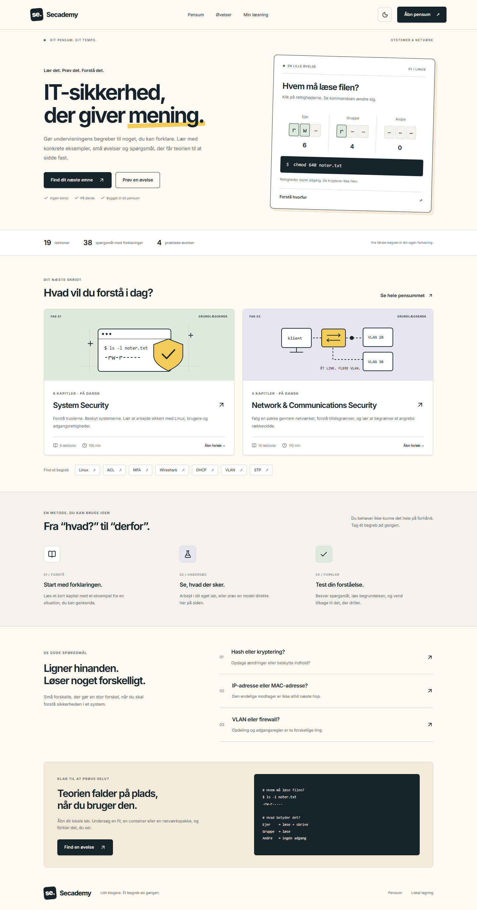

# Secademy

En dansk studiebog i IT-sikkerhed med 19 lektioner, 38 quizspørgsmål og fire praktiske øvelser. Login er slået fra. Alt pensum og læseoversigten kan bruges med det samme.

## Start lokalt

```powershell
npm install
npm run dev
```

Åbn http://localhost:3000. Der kræves ingen Supabase-nøgler eller ekstern database til den nuværende version.

## Det er implementeret

- To fag og ti kapitler baseret på de vedhæftede undervisningsemner.
- Forklaringer med konkrete eksempler, refleksionsopgaver og udfoldelige svar.
- Søgning i kurser, lektioner og fagbegreber.
- Serverrettede quizzer med forklaring på hvert svar. Facit sendes ikke med quizspørgsmålene.
- Lokal fremgang, senest åbnede lektion, quizhistorik og manuel labbekræftelse.
- Fire øvelser: Linux-filrettigheder, Docker, PCAP-læsning og VLAN. VLAN-modellen viser effekten af tag og PVID.
- Education-inspireret design med interaktive eksempler, responsivt layout, lyst/mørkt tema og tastaturadgang.

Fremgang lagres i `localStorage` under `secademy.study.v1`. Den synkroniseres ikke og forsvinder ved sletning af browserdata. Min læsning indeholder en nulstillingsfunktion. Hvis lagring er blokeret, virker læsning og quizrettelse stadig. Resultater er selvstudie, ikke eksamensbeviser.

## Undervisning og design

Se [pensumkortet](docs/curriculum.md) for koblingen til samtlige vedhæftede PDF'er og ZIP-filer og de faglige præciseringer. Kildematerialet er brugt som faglig reference; originalfiler og scripts distribueres ikke med appen.

Designreferencer er undersøgt via Mobbin MCP. Se [designnoter](docs/design.md).



[Mobildesign](docs/screenshots/home-mobile.png) · [Lektionsvisning](docs/screenshots/lesson-desktop.png)

## Kode

- `src/content/courses.ts`: fag, kapitler og lektionsmetadata.
- `src/content/courses/*.mdx`: originalt undervisningsindhold.
- `src/content/labs.ts`: øvelser.
- `src/features/quizzes/`: spørgsmål og serverbaseret bedømmelse.
- `src/lib/local-progress.ts`: versionsvalideret lokal lagring.
- `src/app/globals.css`: design, læsetypografi og responsive layouts.

Next.js 16, React 19, TypeScript, Tailwind CSS og lokalt indlæst Inter. Læs de installerede Next.js-guider i `node_modules/next/dist/docs/` før frameworkændringer.

## Kontrol

```powershell
npm run lint
npm run typecheck
npm test
npm run build
npm run test:e2e
```

Browserkontrollen bruger Microsoft Edge via Playwright og omfatter desktop/mobil, lys/mørk tilgængelighed, alle 19 lektionssider, quiz, lagring, nulstilling og VLAN-modellen. `node scripts/screenshots.mjs` opdaterer skærmbilleder ved kørende udviklingsserver.

## Bevaret backend til senere

Supabase-migrationer og tidligere kontofunktioner er bevaret, men integrationen er eksplicit deaktiveret i `src/lib/supabase/server.ts`. De tidligere auth- og profilsider viderestiller til Min læsning. Proxyen laver ingen sessionsopslag, og aktive læse- og quizflows kontakter ikke Supabase.

RLS er ikke lempet. Databasetests kontrollerer stadig ejerskab og beskyttet bedømmelse til en eventuel senere genindførelse af konti. Seed genereres med `npm run seed:generate`. Konti bør først genaktiveres efter særskilt opsætning og test af hele loginflowet.

Ingen ekstern deployment er foretaget. Browserflows er verificeret lokalt; Docker/Linux-kommandoer er undervisningseksempler og er ikke afviklet på brugerens maskine.
